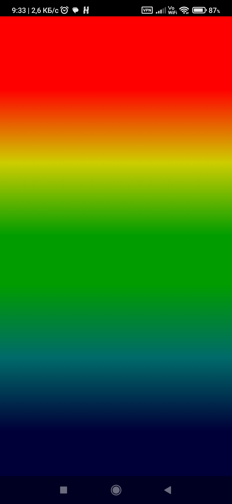
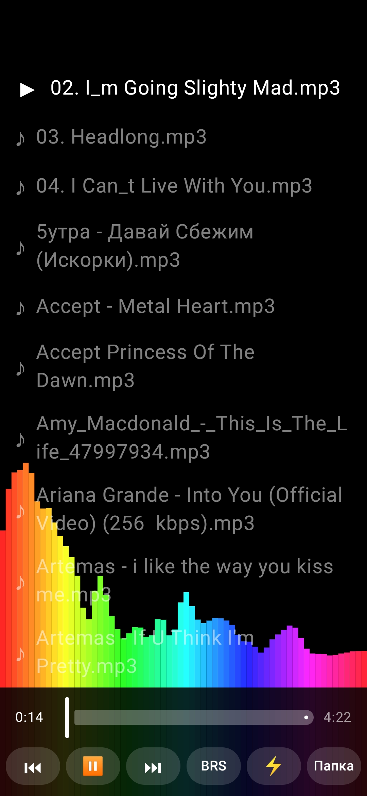
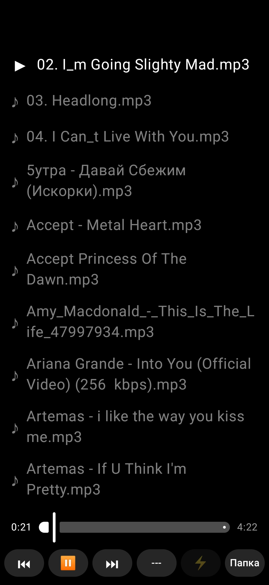

# RGB Player v2

A simple Android music player with a colorful RGB visualizer.

I created this project as a personal experiment in Android development, combining music playback with a full-screen color visualization and audio spectrum display.

## Features

- Local music playback
- Audio spectrum visualizer
- Full-screen RGB color gradient
- Colorful animated music visualization
- Playlist / file list
- Playback controls (Previous, Play/Pause, Next)
- Simple interface
- Android application

## Screenshots

Screenshots of the application are available below.

## Download

Download the APK from the Releases section:

https://github.com/okolyda1970-dotcom/RGB-Player-v2/releases

Install the APK on your Android device.

## Development

This project was developed for Android using Kotlin.

AI tools were used to assist with development.

## Feedback

This is a personal project. Feedback, suggestions and bug reports are welcome!

If you try the app, please let me know what you think.

---

Created by okolyda1970-dotcom
## Screenshots

### Music Player

### RGB Visualizer

### Spectrum Analyzer

